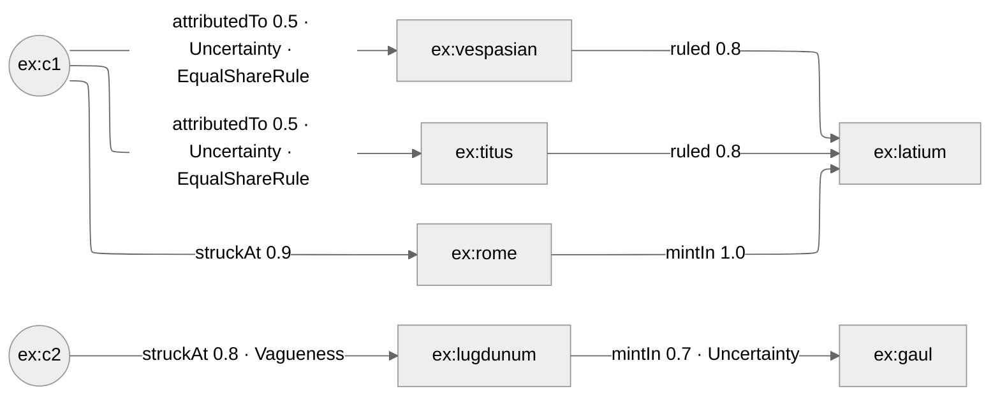

# Hextuple demo — type and method on statements

An AMT statement is a quadruple: subject, role, object, weight. The FW
ontology (<http://w3id.org/fw_ontology/>, prefix `fw:`) adds two parts, which
make it a hextuple:

| Part | Property | Meaning |
|---|---|---|
| 5 | `fw:hasType` | what kind of fuzziness the weight expresses: `fw:Vagueness`, `fw:Uncertainty`, `fw:FuzzinessWobbliness` |
| 6 | `fw:hasMethod` | how the weight was obtained, e.g. `fw:EqualShareRule`, or the logic that computed it, e.g. `amt:GoedelLogic` |

Both are optional. **A statement without `fw:hasType` is a vagueness
statement**, also at weight 1.0. The engine does not write that default into
its output unless it was in the input, so a plain quadruple stays one. The
weight may be written `amt:weight` or `fw:hasDegreeOfConnection` (the same
thing); the output always uses `amt:weight`.

Run it with:

```bash
python -m amt.runner examples/hextuple-demo.ttl
```

## The coin example

Two coins, two possible issuers, two mints, two regions. Coin 1 is attributed
to Vespasian or Titus with equal share, which is an uncertainty, not a
vagueness: one of them is right, we do not know which.



## What the input shows

| Statement | Weight | Type | Method | Note |
|---|---|---|---|---|
| c1 attributedTo vespasian | 0.5 | Uncertainty | EqualShareRule | plus evidence (`fw:TextEvidence`), passed through unchanged |
| c1 attributedTo titus | 0.5 | Uncertainty | EqualShareRule | |
| c1 struckAt rome | 0.9 | – | – | weight written as `fw:hasDegreeOfConnection` |
| c2 struckAt lugdunum | 0.8 | Vagueness | – | the default written out; stays in the output |
| rome mintIn latium | 1.0 | – | – | weight 1.0 and still a vagueness statement |
| lugdunum mintIn gaul | 0.7 | Uncertainty | – | type without method: note `AMT-N303` |
| vespasian ruled latium, titus ruled latium | 0.8 | – | – | |

## Expected derivations

| Derived statement | Weight | Type | Method | How |
|---|---|---|---|---|
| c1 struckIn latium | 0.9 | – (vagueness) | `amt:GoedelLogic` | min(0.9, 1.0); both antecedents vague, so the default and not written |
| c2 struckIn gaul | 0.7 | `fw:FuzzinessWobbliness` | `amt:GoedelLogic` | min(0.8, 0.7); vagueness and uncertainty differ |
| c1 linkedTo latium | 0.4 | `fw:FuzzinessWobbliness` | `amt:ProductLogic` | 0.5 · 0.8, by Vespasian and by Titus (same weight, one statement); uncertainty and vagueness differ |
| latium producedCoin c1 | 0.9 | – (vagueness) | – | inverse of c1 struckIn latium; no method, type of the source |
| gaul producedCoin c2 | 0.7 | `fw:FuzzinessWobbliness` | – | inverse of c2 struckIn gaul |

The rules behind the table:

- A `RoleChainAxiom` sets the method to its logic. The type is the common type
  of the antecedents; if they differ it is `fw:FuzzinessWobbliness`, the broader
  concept of vagueness and uncertainty. A missing type counts as vagueness.
- `InverseAxiom` and `SubsumptionAxiom` set no method and take the type of the
  source statement.
- If a statement is derived on several paths, the path with the highest weight
  decides type and method; on equal weights the smaller method IRI wins.

## Round trip

`hextuple-demo.reasoned.ttl` can be read again by the engine and gives the same
statements with weight, type and method. The output validates against
`ontology/amt-shapes.ttl`.

## Checks

The file passes validation. Diagnostics report one note, `AMT-N303`, for the
two statements that have a type but no method. See the
[How-To "check an AMT file"](https://alpaca-fair-framework.github.io/amt-engine/howto/validate/).
